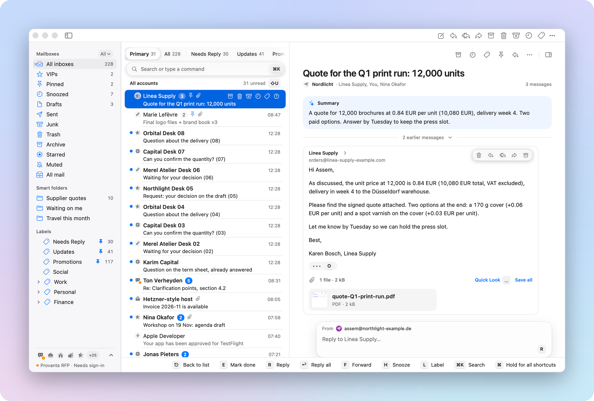
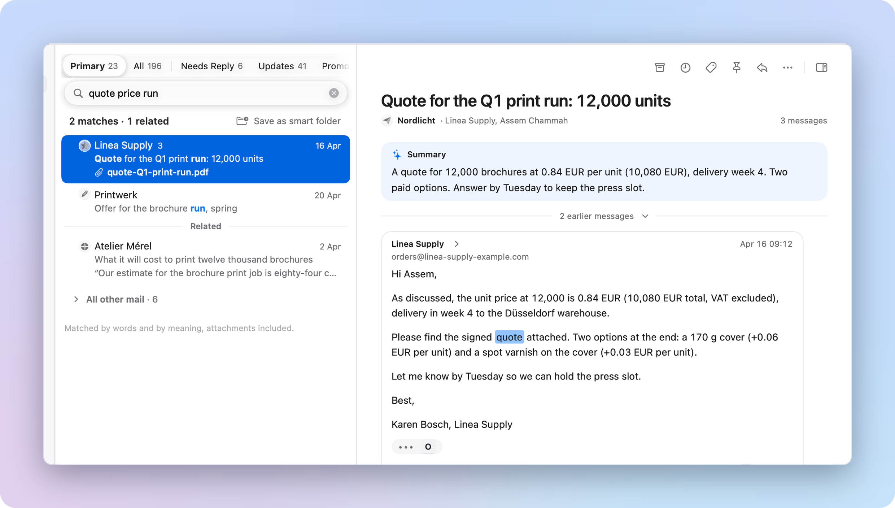
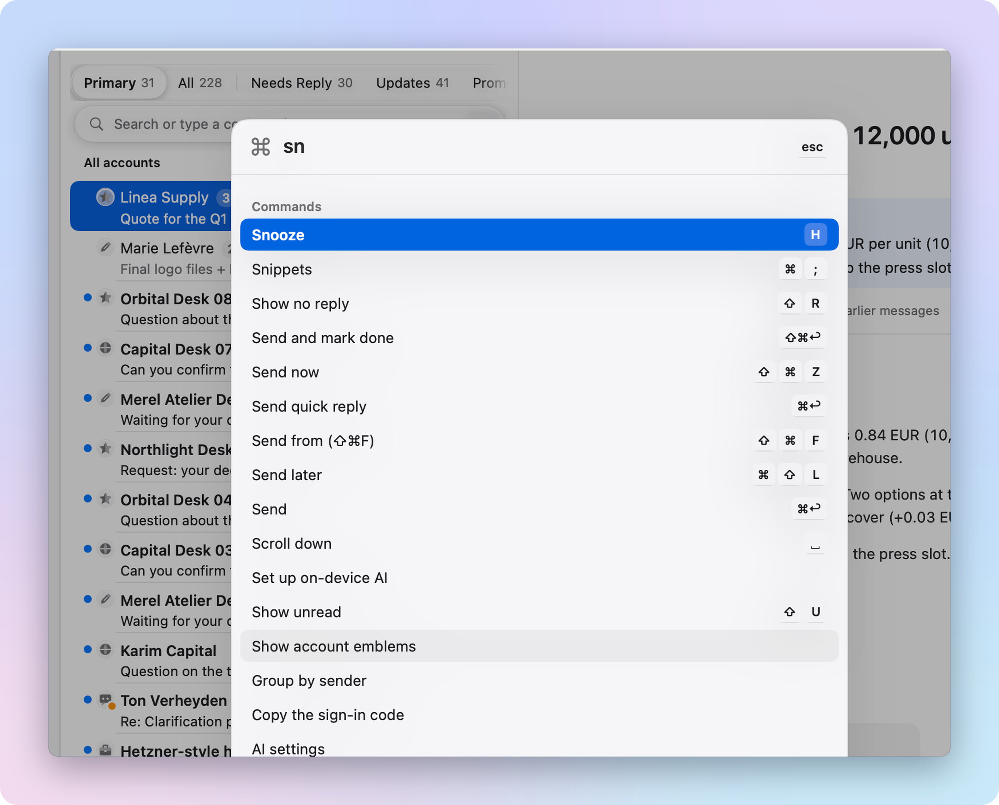
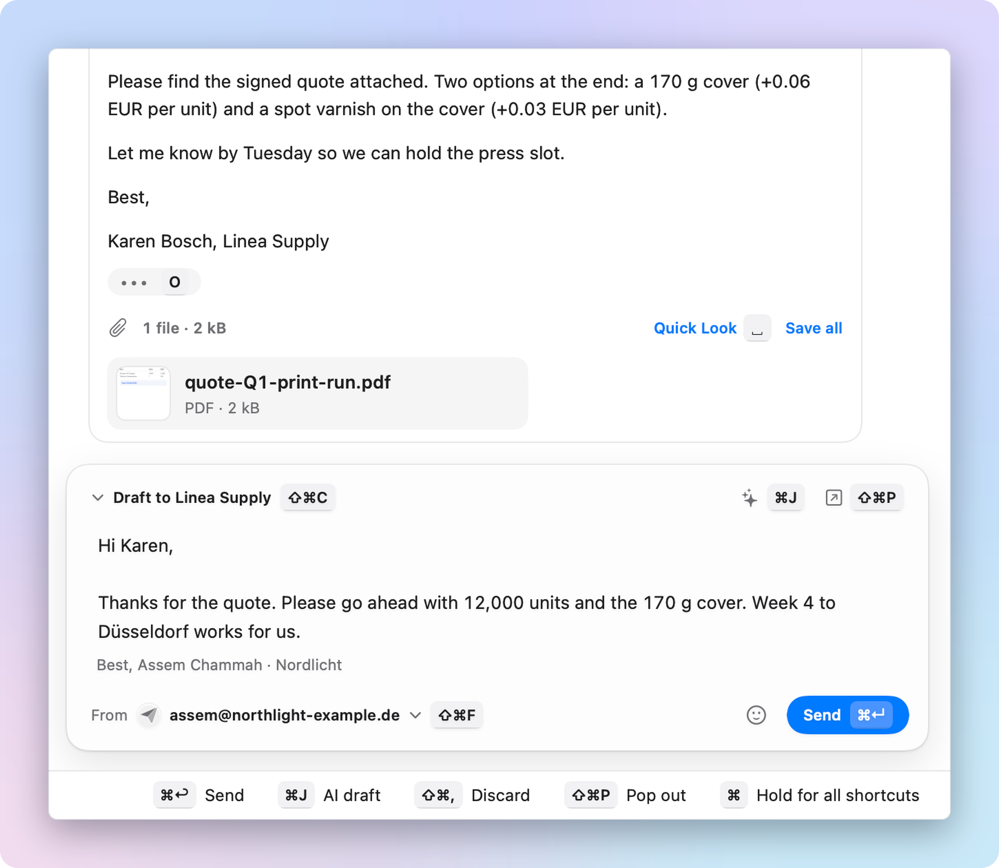
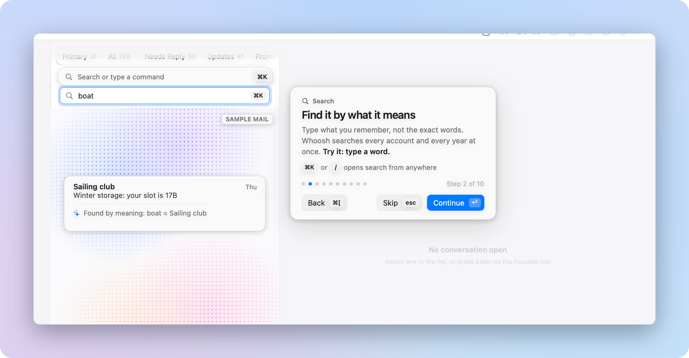
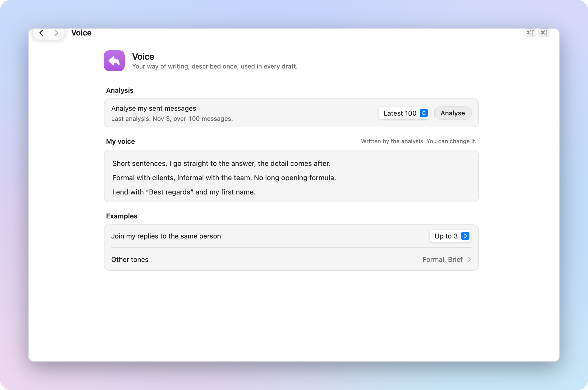
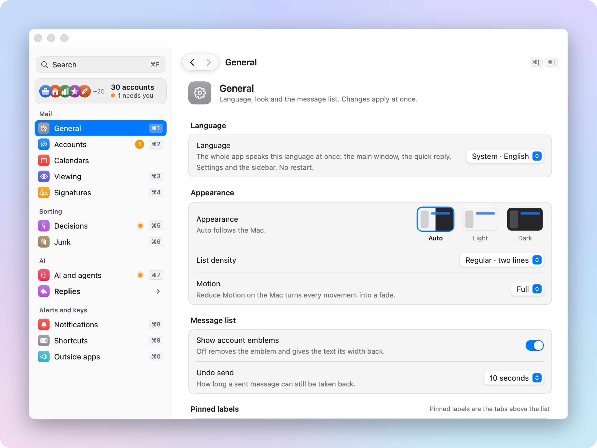
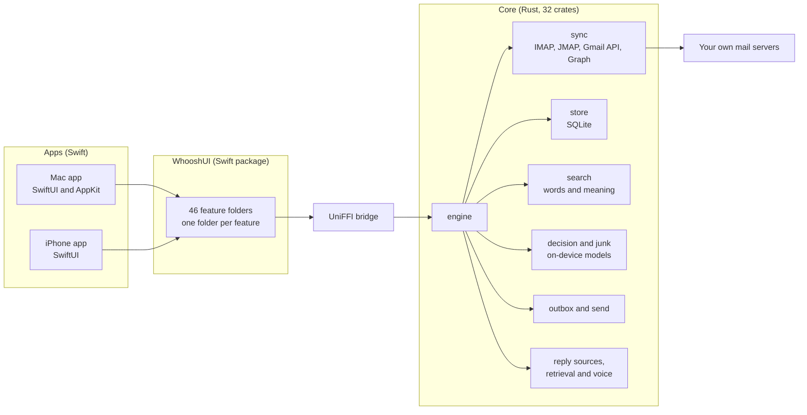
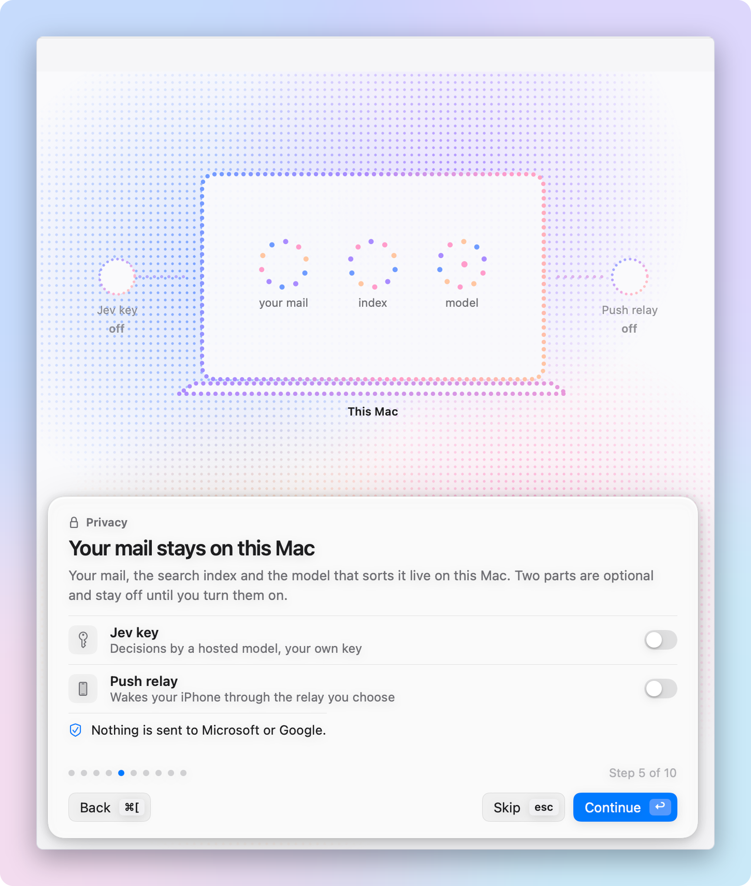

<div align="center">


# Whoosh

**Fast, smooth, truly smart email.**

A native mail client for Mac and iPhone,<br>for people who run many accounts and want one calm window.

<p>


</p>

<picture>
  <source media="(prefers-color-scheme: dark)" srcset="docs/media/inbox-dark.png">
  
</picture>

</div>

## What it is

- **One window for every inbox.** Thirty accounts and more, each with its own mark, in one list with split tabs.
- **Every action has a key, and the key is on screen.** The bar at the bottom always shows the keys that act right now. `⌘P` finds every command, `⌘K` searches.
- **Search that finds the mail.** By its words, and by its meaning, with a model that runs on your Mac. Attachments included.
- **AI that stays yours.** Sorting runs on the device. Replies are written with the provider key you choose, from the sources you allow.
- **Nothing between you and your mail.** No Whoosh account, no telemetry. Your mail lives on your devices and on your own mail servers.

## A look around

### Search by words and by meaning

The mails that hold your words come first. Mails that are close in meaning follow under "Related". The open mail shows where it matched.

<picture>
  <source media="(prefers-color-scheme: dark)" srcset="docs/media/search-dark.png">
  
</picture>

### Every command under ⌘P

Type two letters, press Return. Each line shows its own key, so the palette also teaches the keyboard.

<picture>
  <source media="(prefers-color-scheme: dark)" srcset="docs/media/palette-dark.png">
  
</picture>

### Reply without leaving the conversation

`R` opens the reply under the mail. `⌘↩` sends it, and Undo stays for ten seconds.

<picture>
  <source media="(prefers-color-scheme: dark)" srcset="docs/media/reply-dark.png">
  
</picture>

### A quick start that teaches by doing

Ten short steps on the first launch: try the search, try the keys, connect an account, choose what the AI may use. Settings › General › Quick start shows it again at any time.

<picture>
  <source media="(prefers-color-scheme: dark)" srcset="docs/media/quickstart-dark.png">
  
</picture>

### Replies written like you

Whoosh reads your sent mail once, on the Mac, and describes how you write. You can edit the description. Every draft follows it, and reads only the folders, files and calendars you allow.

<picture>
  <source media="(prefers-color-scheme: dark)" srcset="docs/media/voice-dark.png">
  
</picture>

### Quiet settings, one line each

Fourteen languages. Light and dark. Every control saves at once and says what it does in one line.

<picture>
  <source media="(prefers-color-scheme: dark)" srcset="docs/media/settings-general-dark.png">
  
</picture>

<sub>Every picture on this page comes from the app itself, driven on test data. No real mail is shown.</sub>

## How it is built



| Layer | What it holds |
|---|---|
| `apps/mac`, `apps/ios` | The two app targets. Thin: they host the shared package. |
| `Sources/` | The Swift package `WhooshUI`: design tokens, one folder per feature, the bridge to the core. 943 files. |
| `core/` | The Rust core, one crate per job (`contracts` first), exposed to Swift through UniFFI. 32 crates. |
| `relay/` | The small push relay. It stores device tokens and routing ids, never a mailbox password. |

One rule shapes all of it: the interface never waits on the network. Everything fetched is kept in the local database and served from there.

## Run it

Requirements: a Mac with Xcode 26, Rust (stable, through rustup), Python 3.12 and `xcodegen` (`brew install xcodegen`).

```sh
git clone https://github.com/NexusGPT/whoosh.git
cd whoosh
sh scripts/build.sh dev .        # builds build/Whoosh-dev, stamped with its commit
open build/Whoosh-dev/Build/Products/Debug/Whoosh.app
```

The first launch opens the quick start. To look at the app on test data instead of your own mail:

```sh
open -n build/Whoosh-dev/Build/Products/Debug/Whoosh.app --args --fixture-core
```

## Prove it

```sh
sh scripts/gates.sh              # the contract, the constants and the Rust core: one verdict
GATES_SWIFT=1 sh scripts/gates.sh   # the same, plus a compile check of the Swift sources (needs one finished build)
```

Green prints `GATES GREEN at <commit>`.

The driven checks (`checks/`, `journeys/`) start one hidden copy of the app under a test identity and drive it through its own socket. No window opens, and an installed copy is never touched:

```sh
sh scripts/launch-one.sh build/Whoosh-dev/Build/Products/Debug/Whoosh.app -- --fixture-core --rig-hidden \
  sh -c 'WHOOSH_SOCKET_DIR="$D" python3 journeys/run.py J1'
```

A check counts only after it has been seen red on a deliberately broken copy (`docs/TESTING.md`).

## Where things are

| Path | What you find there |
|---|---|
| `Sources/Features/<Feature>/` | One folder per feature of the interface. |
| `Sources/Design/` | Colours, type, spacing and motion, generated from `docs/CONSTANTS.md`. |
| `core/crates/` | The Rust core: `engine`, `store`, `sync-imap`, `search`, `decision`, `outbox` and their neighbours. |
| `apps/` | The Mac and iPhone targets (`project.yml`, generated into an Xcode project at build time). |
| `checks/`, `journeys/`, `perf/`, `Tests/` | Driven checks, end-to-end journeys, speed and memory measures, unit tests. |
| `scripts/` | The pipeline: build, launch one hidden copy, gates, install, sweep. |
| `docs/` | The specification, the journeys, the data map, the design lock and the test plan. |
| `fixtures/` | The test mail and accounts the checks run on. |

## What it deliberately does not do

<picture>
  <source media="(prefers-color-scheme: dark)" srcset="docs/media/privacy-dark.png">
  
</picture>

- **No account with us.** There is no Whoosh login and no Whoosh server that holds your mail or a mailbox password.
- **No telemetry.** The app sends nothing about what you do.
- **No AI call you did not choose.** Sorting and search run on the device. A reply draft uses the provider you connected, with your key.
- **No remote pictures by surprise.** Tracking pixels are blocked, and a mail's pictures load when you say so.

<br clear="both">

## Status

Whoosh is in active development and runs daily on its author's own mail.

- **Works today:** IMAP accounts with send, the inbox with split tabs and labels, search by words and by meaning, the quick reply and the composer, snooze and reminders, the command palette, the notch alerts, the quick start, fourteen languages, light and dark.
- **Not built yet:** one-click sign-in for Google and Microsoft accounts (it waits for the app registrations; IMAP with an app password works), a notarised download, push on a real iPhone, and several speed budgets that still wait for their final measure.

## Licence

MIT. See [LICENSE](LICENSE). The licences of the libraries Whoosh builds on are listed in [docs/LICENCES.md](docs/LICENCES.md).

The names and marks of other products (mail services, AI providers) belong to their owners. They appear only to name the service an account or a key connects to.
